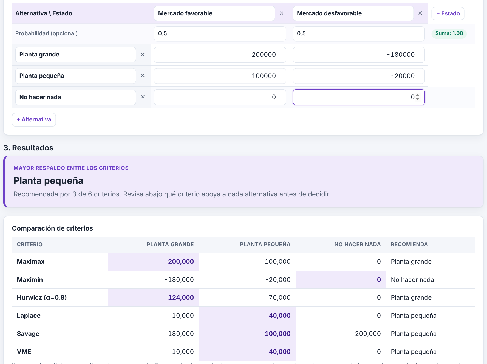
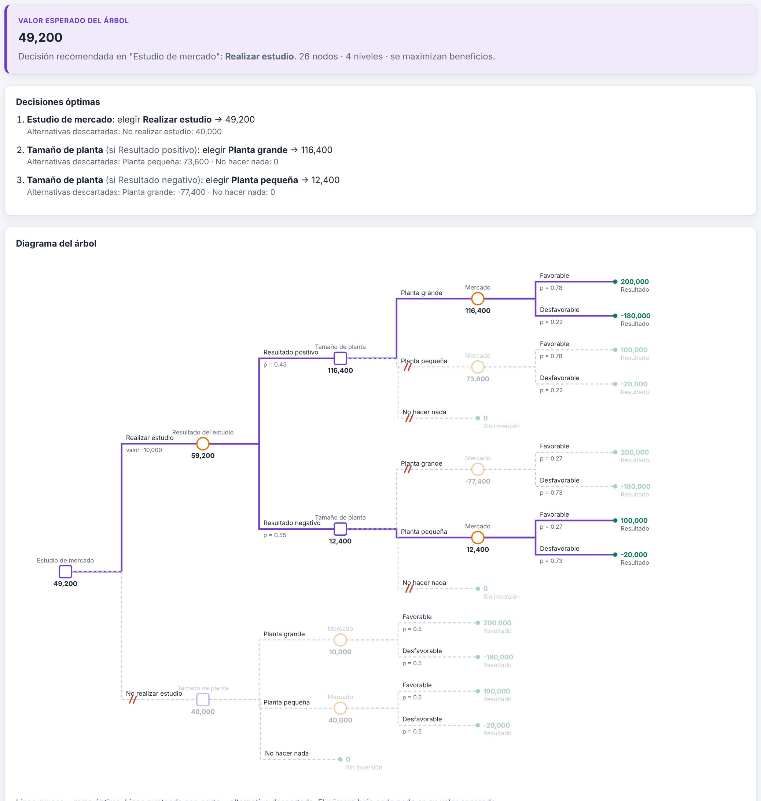
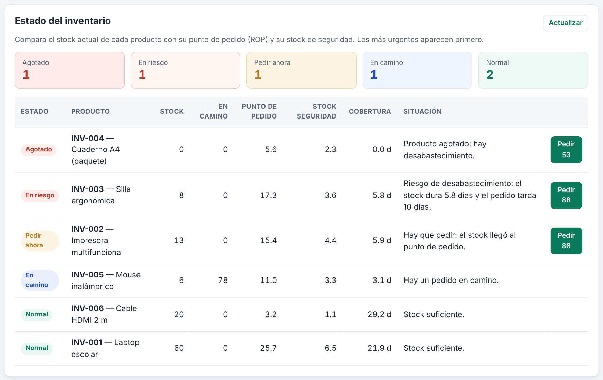
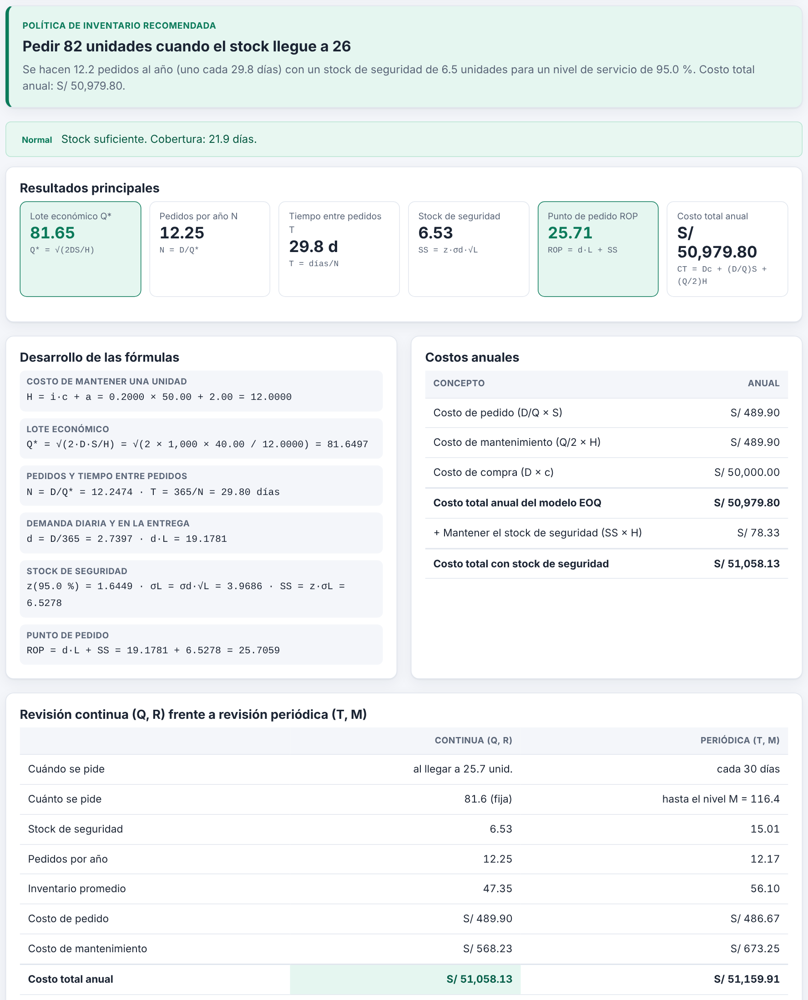
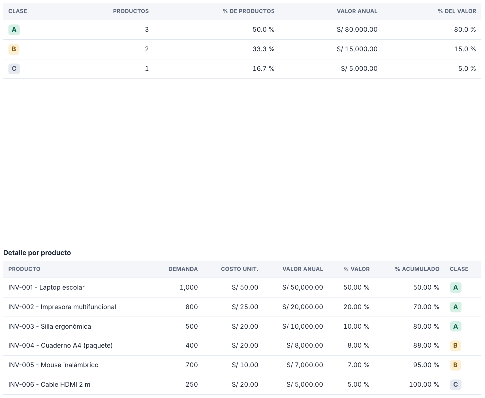
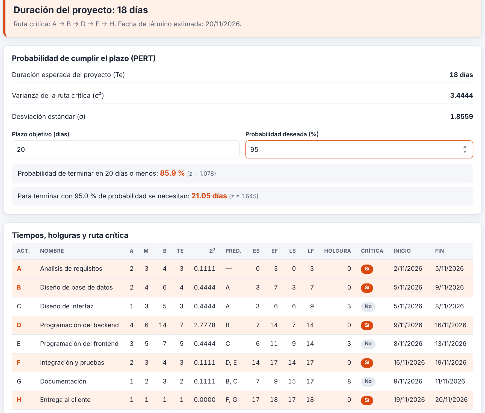
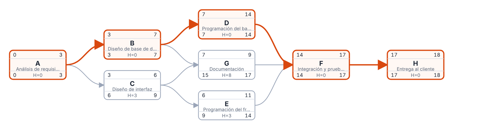
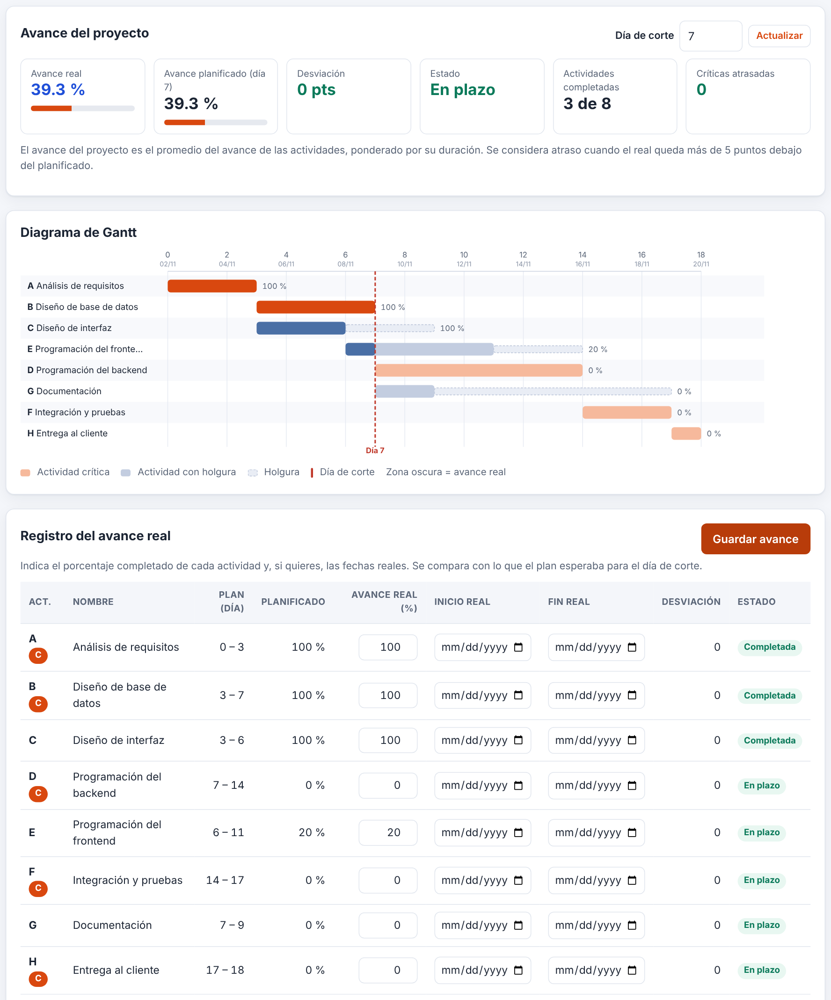

# Sistema de apoyo a la toma de decisiones · Investigación Operativa II

Aplicación web que integra tres técnicas de Investigación Operativa en un solo sistema:

| Módulo | Qué resuelve |
|---|---|
| **PERT/CPM** | Ruta crítica, holguras, tiempos esperados y probabilidad de terminar en plazo, diagrama de red, Gantt y seguimiento de avance |
| **Inventarios** | EOQ, punto de reorden, stock de seguridad, revisión continua vs. periódica, clasificación ABC, movimientos, órdenes de pedido y alertas |
| **Teoría de decisiones** | Maximax, Maximin, Hurwicz, Laplace, Savage, VME, VEIP y árboles de decisión con roll-back |

**Stack:** HTML + CSS + JavaScript (frontend) · Node.js + Express (backend) · SQL Server (`mssql`) · Chart.js (gráficos).

**Sistema en línea:** https://io2-sistema-decisiones.onrender.com

> Universidad Nacional Jorge Basadre Grohmann (UNJBG) · Ingeniería de Sistemas · Investigación Operativa II

---

## Capturas

| Decisiones: matriz de pagos | Decisiones: árbol |
|---|---|
|  |  |

| Inventarios: alertas | Inventarios: análisis EOQ |
|---|---|
|  |  |

| Inventarios: ABC | PERT: resultados |
|---|---|
|  |  |

| PERT: red de actividades | PERT: Gantt |
|---|---|
|  |  |

---

## Requisitos

- [Node.js](https://nodejs.org) 18 o superior (probado con 22)
- SQL Server (Express/Developer/LocalDB) y SQL Server Management Studio (SSMS)
- Con autenticación de Windows: *ODBC Driver 18 for SQL Server* (el paquete opcional `msnodesqlv8` lo usa)

## Instalación

```bash
git clone <url-del-repositorio>
cd io2-sistema-decisiones
npm install
```

1. **Configurar el entorno**: copiar `.env.example` a `.env` y ajustar `DB_SERVER`, `DB_NAME` y el tipo de autenticación.
   - `DB_AUTH=windows` (por defecto): no requiere usuario ni contraseña.
   - `DB_AUTH=sql`: completar `DB_USER` y `DB_PASS`.
2. **Crear la base de datos**: abrir en SSMS y ejecutar **en este orden** los scripts de `database/`:

   | Orden | Script | Contenido |
   |---|---|---|
   | 1 | `00_create_database.sql` | Crea la base `IO2_Sistema` |
   | 2 | `01_schema_pert.sql` | Tablas de PERT/CPM |
   | 3 | `02_schema_inventario.sql` | Tablas de Inventarios |
   | 4 | `03_schema_decisiones.sql` | Tablas de Decisiones |
   | 5 | `99_seed_data.sql` | Datos de ejemplo (opcional, recomendado) |

3. **Iniciar el servidor**:

   ```bash
   npm run dev     # con recarga automática
   npm start       # modo normal
   ```

4. Abrir **http://localhost:3000**. Comprobación rápida de la API: http://localhost:3000/api/health

## Despliegue en la nube

**Aplicación publicada:** https://io2-sistema-decisiones.onrender.com  
Comprobación de la conexión con la base de datos: https://io2-sistema-decisiones.onrender.com/api/health

> Nota: el plan gratuito de Render suspende el servicio tras 15 minutos sin uso; la primera visita después de una pausa puede tardar cerca de un minuto en responder.

El proyecto incluye `render.yaml` para desplegar la aplicación en **Render** con la base de datos en **Azure SQL**. Guía paso a paso: [`docs/despliegue.md`](docs/despliegue.md). Para cargar los datos en la nube se usa `database/cloud_todo_en_uno.sql`.

## Pruebas

```bash
npm test
```

Ejecuta 116 pruebas (`node --test`) de los algoritmos y de los controladores (con la base de datos simulada, no requiere SQL Server). También corren en GitHub Actions en cada push (`.github/workflows/test.yml`).

## Estructura del proyecto

```
├── backend/
│   ├── server.js            # Express: API + archivos estáticos
│   ├── config/              # conexión a SQL Server
│   ├── routes/              # rutas por módulo
│   ├── controllers/         # validación y acceso a datos
│   ├── services/            # algoritmos puros (criterios, árbol, EOQ, ABC, CPM, seguimiento...)
│   └── tests/               # pruebas automáticas
├── database/                # scripts SQL numerados
├── frontend/
│   ├── index.html           # portal
│   ├── pages/               # una página por módulo
│   ├── css/  js/            # estilos y lógica (common + un directorio por módulo)
└── docs/                    # manual, evidencias, informe, imágenes
```

## API (resumen)

Todas las respuestas tienen la forma `{ ok: true, ... }` o `{ ok: false, error }`.

**Decisiones** `/api/decisiones`
`GET /` · `POST /calcular` · `POST /` · `GET /:id` · `GET /:id/analisis` · `PUT /:id` · `DELETE /:id`
`GET /arboles` · `GET /arboles/ejemplo` · `POST /arboles/calcular` · `POST /arboles` · `GET|PUT|DELETE /arboles/:id`

**Inventario** `/api/inventario`
`/proveedores` (CRUD) · `/productos` (CRUD) · `GET /productos/:id/analisis` · `POST /calcular` · `GET /abc?corteA=80&corteB=95` · `GET /alertas` · `/movimientos` · `/ordenes` · `POST /ordenes/:id/recibir`

**PERT/CPM** `/api/pert`
`GET /` · `POST /calcular` · `POST /` · `GET /:id` · `GET /:id/analisis?plazo=&probabilidad=&dia=` · `PUT /:id/seguimiento` · `PUT /:id` · `DELETE /:id`

## Fórmulas implementadas

- **PERT:** `te = (o + 4m + p) / 6`, `σ² = ((p − o) / 6)²`, `z = (plazo − Te) / σ`, `P = Φ(z)`.
- **CPM:** pasada hacia adelante (ES, EF) y hacia atrás (LS, LF); holgura = LS − ES; ruta crítica = holgura 0.
- **EOQ:** `H = i·c + a`, `Q* = √(2DS/H)`, `N = D/Q*`, `CT = D·c + (D/Q)S + (Q/2)H`.
- **Reorden:** `SS = z·σd·√L`, `ROP = d·L + SS`; revisión periódica `M = d(T+L) + z·σd·√(T+L)`.
- **Decisiones:** Hurwicz `α·máx + (1−α)·mín`, Laplace (promedio), Savage (matriz de arrepentimiento), `VME`, `VEIP = VEcIP − VME`.

## Validación

Los resultados se contrastaron con cálculos manuales (casos clásicos: Thompson Lumber → 49,200 vs 40,000; red PERT de ejemplo → 18 días, P(≤20)=85.94 %, etc.). Ver [`docs/evidencias_pruebas/validacion.md`](docs/evidencias_pruebas/validacion.md).

## Documentación

- [Manual de usuario](docs/manual_usuario.md)
- [Evidencias de validación](docs/evidencias_pruebas/validacion.md)
- Informe técnico: `docs/informe/Informe_Tecnico.docx`

## Autor

Proyecto académico individual. Datos de autor y docente en el informe técnico.
